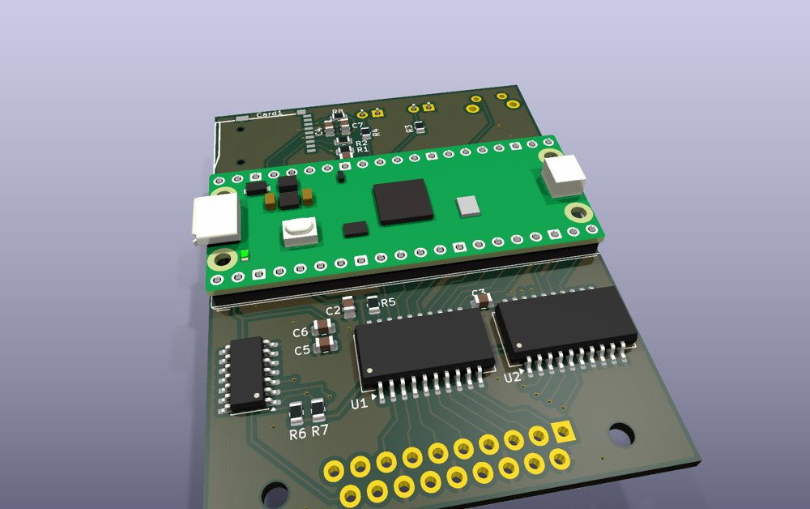
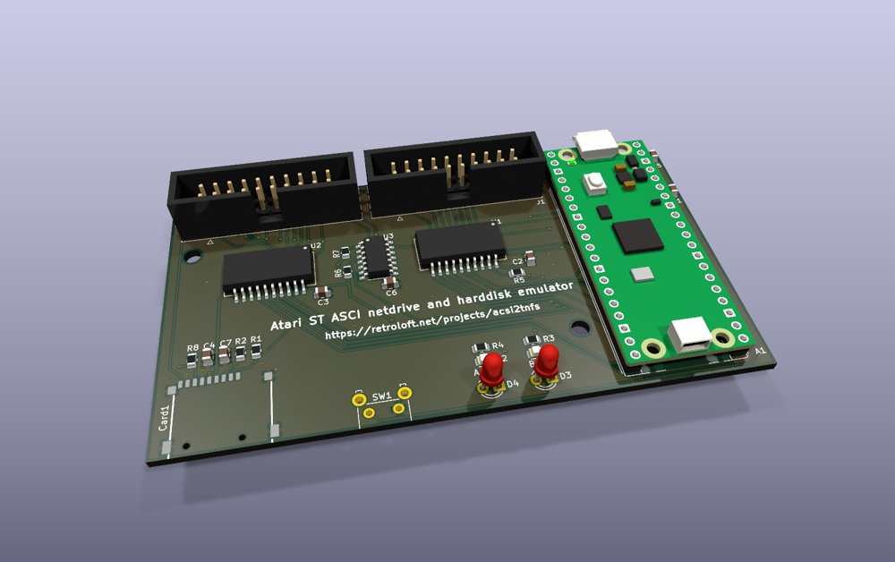
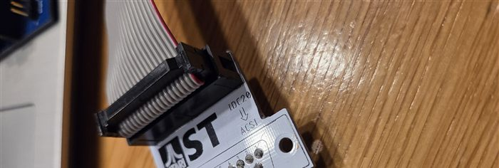
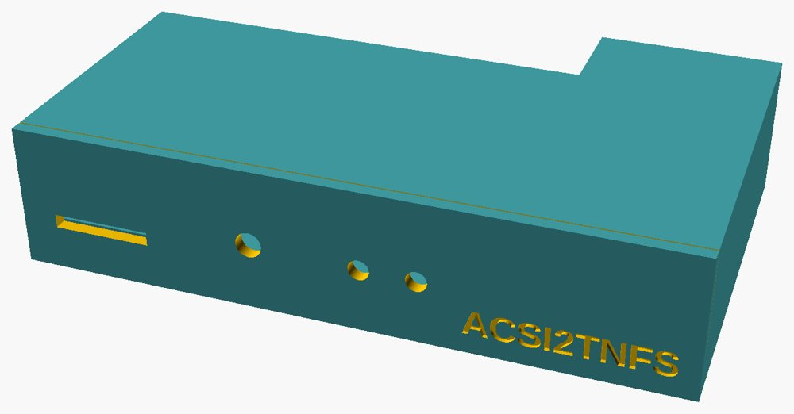

# ACSI2TNFS hardware

There are two boards with the same circuit, so one firmware fits both. Only the way
they connect to the Atari's ACSI port differs:

- **`v2`** plugs straight into the ACSI port, without a cable.
- **`v2-cable`** connects through a Lotharek DB19 adapter and a 20-wire flat cable, and
  can pass the ACSI bus on to another device, such as Lotharek's UltraSatan.

> **Firmware:** the current firmware still uses the pin map of the earlier development
> board. A board setting for `v2` / `v2-cable` (different GPIOs, see the pin map below)
> is still to come.

## Which one?

| | `v2` | `v2-cable` |
|---|---|---|
| Connection | plugs straight into the ACSI port | 20-wire flat cable to a Lotharek DB19 adapter in the ACSI port |
| Where it sits | upright on the back of the Atari, sticking out above it: leds, button and SD card in sight | loose on or behind the Atari |
| Pass-through | no | yes: a second header for another ACSI device, e.g. an UltraSatan |
| Case | none | a 3D-printable case (`v2-cable/case/`) |
| Special parts | 19 WAGO 243-131 pins for the DB19 | a Lotharek adapter (or build `acsi-adapter`) and a flat cable |

| `v2` | `v2-cable` |
|---|---|
|  |  |

*3D views from KiCad. Not every part has a 3D model (the SD socket and the button are
missing).*

## v2: straight into the ACSI port

The DB19 plug is part of the board: 19 loose pins soldered into the board take the place
of a DB19 plug (footprint `ACSI_DB19_Male_WAGO_243-131`). The board stands upright on
the back of the Atari, held by the port, and sticks out above it, so the leds, the
button and the micro SD card are in sight.

- **Pro:** no adapter and no cable needed.
- **Con:** you need the special pins: **WAGO 243-131** solder pins (1.0 mm pins in
  1.2 mm holes), 19 per board. For example from
  [Farnell](https://nl.farnell.com/en-NL/wago/243-131/solder-pin-2mm-pcb-terminal-block/dp/2643506)
  or [RS](https://nl.rs-online.com/web/p/terminal-block-accessories/2885173).
- No pass-through: the board takes the ACSI port.

## v2-cable: with a Lotharek adapter

The board lies loose on or behind the Atari and hangs on a Lotharek DB19 adapter through
a 20-wire flat cable. That adapter comes with Lotharek's
[UltraSatan](https://lotharek.pl/products.php?id=15): if you already have one, this is
the easiest way.

- **J1 "To ACSI"** takes the cable from the adapter. **J2 "ACSI pass-through"** carries
  the same signals on, e.g. to the UltraSatan, which then shares the bus with its own
  ACSI id.
- J1 and J2 are keyed box headers. Their pins are numbered **per row**: 1-10 along the
  row on the side of the key, 11-20 along the other row (footprint
  `IDC-Header_2x10_P2.54mm_Vertical_NR_PER_ROW`).
- So **pin n on the board is ACSI pin n**, because the adapter puts DB19 pins 1-10 on one
  row of its header and 11-19 on the other. This is **not** the usual IDC numbering
  (1 and 2 opposite each other): a standard 2x10 footprint would mix up the signals.
- The cable is a straight 20-wire flat cable with an IDC socket at each end, keyed the
  same way at both ends.

| Pin | Signal | Pin | Signal |
|---|---|---|---|
| 1-8 | DATA0-DATA7 | 11, 13, 15, 17 | GND |
| 9 | /CS | 12 | /RESET |
| 10 | /IRQ | 14 | /ACK |
| | | 16 | A1 |
| | | 18 | R/W |
| | | 19 | /DRQ |
| | | 20 | not used |

### No Lotharek adapter? Make one

`acsi-adapter` is the same adapter as a KiCad project: the DB19 of `v2` (the same special
pins) wired 1:1 to the IDC20 box header of `v2-cable`, pin 20 not connected. The box
header sits on the side of the wide DB19 row, like on Lotharek's adapter.

### The case

`v2-cable/case/` holds a 3D-printable case: `case.scad` (OpenSCAD) and ready STL files.

- **Bottom** with a flat front panel: the SD socket ends flush with it, the button
  sticks out about 1 mm, and the two 3 mm leds sit in holes. "ACSI2TNFS" is engraved in
  the corner.
- **Two lids:** `lid-vertical` for straight box headers (the rear left corner is open,
  with walls around the headers), `lid-right-angle` for angled box headers (openings in
  the rear wall).
- Two **M2.5 countersunk screws** (about 12 mm) from below, through the bottom and the
  board into plugs of the lid.
- Print the bottom as it is and the lid upside down (as in the STL files). No supports
  needed.
- **Assembly:** the SD socket and the button go through the front panel. Put the board
  in at the rear, slide it forward until the socket is flush with the panel, then screw
  it down. Trim the pins under the board to about 2.5 mm.
- The lid height is for a Pico on female headers (about 12.5 mm above the board).
  Heights and openings can be changed at the top of `case.scad`.

## Getting a board

Choose your version first, then whether you order the board ready-made or build it
yourself.

### Ordering it assembled

The boards are made for [JLCPCB](https://jlcpcb.com), which makes the board and solders
the SMD parts:

1. In KiCad, make the production files with the plugin
   [Fabrication Toolkit](https://github.com/bennymeg/Fabrication-Toolkit): it writes the
   Gerber zip, `bom.csv` and `positions.csv` into `production/`.
2. At JLCPCB upload the Gerber zip and switch on **PCB Assembly**, top side.
3. **Quantity:** 2, 5 or a multiple of 5. For 2 boards choose a **green** board: other
   colours start at 5.
4. Upload `bom.csv` and `positions.csv`. Parts without an LCSC number in the schematic
   are picked in the BOM step. **U1 and U2** must be the wide SOIC-20 version,
   **74LVC245ADW** (the schematic value says APW, which is the small TSSOP package).
5. **Check the placement preview:** the rotation of some parts is often wrong. For
   every IC, led and the SD socket the dot at pin 1 of the part must sit on the pin-1
   mark of the footprint; rotate the part in the preview where it does not.
6. The cheapest shipping works fine: boards usually arrive in the Netherlands from China
   in 10 to 14 days.

The through-hole parts (Pico headers, box headers or DB19 pins, button, 3 mm leds) are
easy to solder yourself afterwards, or ask JLCPCB to fit them too.

### Building it yourself

All SMD parts are on the top side and have a pin pitch of 1.1 mm or more, so a
**hotplate** works well:

1. **SMD parts on the hotplate.** Put a tiny dot of solder paste on each pad: a dot is
   enough to solder a pin to its pad. With too much paste neighbouring pins bridge. A
   stencil is not needed.
2. Place the parts with tweezers, heat the board until the paste flows, let it cool.
3. **Through-hole parts** with a normal soldering iron: Pico headers, box headers or
   DB19 pins, button, leds.

Plenty of videos show hotplate soldering. Useful tools: reading glasses or a magnifier,
good light, tweezers, and a **toothpick**: it is not magnetic and good for moving paste
and parts.

### Parts

| Ref | Part | Package | Notes |
|---|---|---|---|
| A1 | Raspberry Pi Pico 2 W | module | on female headers (socket) or soldered |
| U1, U2 | 74LVC245ADW | SOIC-20W | wide SOIC, not TSSOP |
| U3 | 74LS07 | SOIC-14 | |
| Card1 | TF-01A micro SD socket (LCSC C91145) | SMD | push-push |
| R1, R2, R5-R8 | 10k | 0805 | |
| R3, R4 | 330 Ω | 0805 | led resistors |
| C1, C5, C7 | 10 µF | 0805 | |
| C2, C3, C4, C6 | 100 nF | 0805 | |
| SW1 | 6 mm tactile switch, right angle (Alps SKHH footprint) | THT | |
| D1, D2 (`v2`) | led 3 mm | THT | bent forward |
| D1, D2 / D3, D4 (`v2-cable`) | led 0805 / led 3 mm | SMD / THT | fit **either** D1 **or** D3, and D2 **or** D4 |
| J1 (`v2`) | 19 × WAGO 243-131 | THT | the DB19 plug |
| J1, J2 (`v2-cable`) | 2x10 box header, 2.54 mm, straight or right angle | THT | the lid of the case depends on it |

## Both boards

- **Raspberry Pi Pico 2 W** on pin headers. The Pico powers the board from USB; the
  ACSI port has no supply pin.
- **U1** 74LVC245: data bus D0-D7, direction (DIR) and enable (/OE) from the Pico.
  **U2** 74LVC245: /CS, /RESET, /ACK, A1 and R/W to the Pico, fixed direction.
  **U3** 74LS07: /IRQ and /DRQ as open-collector outputs.
- **Card1:** micro SD socket on SPI0, with card detect.
- **SW1:** button (hidden mode on/off). **Leds:** power and status.

### Design rules learnt the hard way

The Atari's floppy controller shares the ACSI data bus and the /IRQ line, so the board
must keep off them when it is not talking:

- **No pull-ups on /IRQ and /DRQ** to the board's own supply: without USB that supply is
  0 V and the resistors pull the lines low, which upsets the floppy drive. The Atari has
  its own pull-ups.
- **10k pull-up on /OE of U1** (R5): the data bus buffer stays off while the Pico is not
  running (power-up, reset, BOOTSEL).
- **10k pull-ups on the 74LS07 inputs** (R6, R7): a Pico in reset pulls its pins low,
  which would otherwise assert /IRQ and /DRQ.

### Pin map (v2 and v2-cable)

| Pico | Signal | Pico | Signal |
|---|---|---|---|
| GP0 | power led | GP16 | /CS |
| GP1 | SD card detect | GP17 | /RESET |
| GP2-GP5 | SD card: CLK, MOSI, MISO, CS | GP18 | /ACK |
| GP6-GP13 | DATA7 ... DATA0 (reversed order) | GP19 | A1 |
| GP14 | DIR of U1 | GP20 | R/W |
| GP15 | /OE of U1 | GP21 | /IRQ (via U3, low = active) |
| GP26 | button | GP22 | /DRQ (via U3, low = active) |
| GP28 | status led | | |

## Files

Each folder is a KiCad 9 project with `schema.pdf`. The project's own footprints are in
`footprints.pretty`; `fp-lib-table` points KiCad to it, so keep it with the project.
There are no Gerber files in the repository: make them from the version you want to
order (see [Ordering it assembled](#ordering-it-assembled)). `images/` holds the
pictures on this page.
